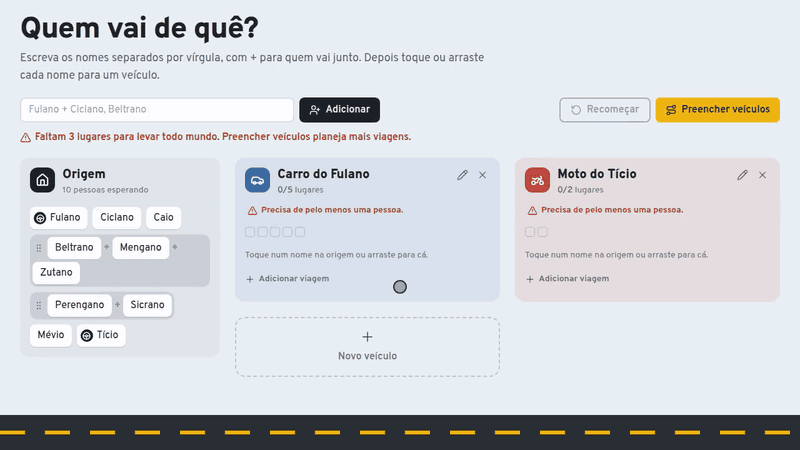
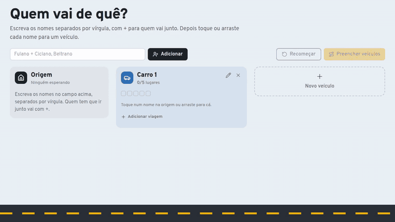
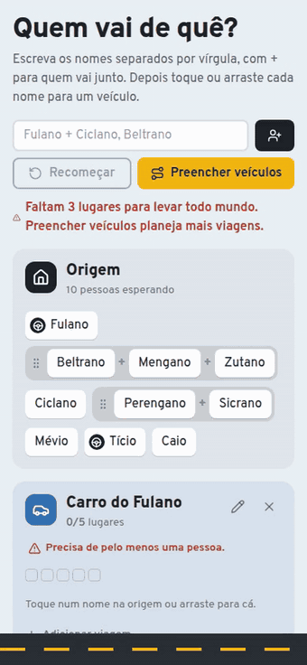

# Quem vai de quê?

Planejador para dividir um grupo de pessoas entre os veículos disponíveis: quem vai em qual carro, moto ou ônibus, quem dirige e quantas viagens cada veículo precisa fazer.

Teste em **https://quem-vai-de-que.vercel.app/**



## Como usar

No computador: adicionar as pessoas, renomear o carro, criar uma moto, marcar quem dirige e preencher os veículos.



No celular, tocar num nome abre um menu com os destinos e os lugares livres em cada um:



## O que dá para fazer

- **Adicionar pessoas** de uma vez, separadas por vírgula. Quem tem que ir junto vai com `+` (`Fulano + Ciclano, Beltrano`).
- **Adicionar e editar veículos** (nome e número de lugares). O tipo (moto, carro ou ônibus) sai do número de lugares. Se os lugares diminuírem, quem não cabe mais volta para a origem, e o aviso mostra quem antes de salvar.
- **Levar cada pessoa para um veículo** arrastando o nome ou tocando nele. O toque abre um menu com os destinos e os lugares livres em cada um, e é o caminho que funciona no celular.
- **Grupos**:
  - Soltar um nome em cima de outro junta os dois.
  - Arrastar um nome de dentro do grupo leva só essa pessoa e a tira do grupo.
  - Arrastar pela alça leva o grupo inteiro.
- **Motoristas e viagens**: marcar quem dirige permite que o veículo faça mais de uma viagem. Da segunda em diante, o motorista volta para buscar e ocupa um lugar.
- **Preencher veículos**: distribui automaticamente quem ainda está na origem. O algoritmo garante um motorista por veículo, nunca separa um grupo e planeja viagens extras se faltar lugar.
- **Desfazer**: ações que tiram alguém do lugar podem ser desfeitas pelo aviso ou com Ctrl+Z.

O plano fica salvo no navegador (localStorage).

## Tecnologias

React 19 com React Compiler, TypeScript, Vite, Tailwind CSS v4, ícones Lucide, Biome para lint e formatação, e Bun para pacotes e testes.

## Como rodar

```sh
bun install
bun dev
```

| Comando | O que faz |
|---|---|
| `bun dev` | servidor de desenvolvimento |
| `bun run build` | checagem de tipos e build de produção em `dist/` |
| `bun run preview` | serve o build localmente |
| `bun test` | testes da lógica das viagens |
| `bun run lint` | lint com Biome |
| `bun run check` | formata, faz o lint e organiza os imports, aplicando as correções seguras |

## Estrutura

```
src/
  viagem.ts        classe Plano: toda a lógica das viagens (imutável)
  viagem.test.ts   testes da lógica
  veiculo.ts       tipos de veículo (moto, carro, ônibus) por número de lugares
  salvar.ts        leitura e escrita no localStorage
  texto.ts         formatação de textos (ordinal, listas de nomes, plural)
  App.tsx          página: cabeçalho, barra de ações, desfazer
  components/
    ui/            peças reutilizáveis (avisos, botões, estilos, ícone de volante)
    veiculo/       diálogo de novo veículo e de edição
    quadro/        origem, painéis dos veículos, nomes, grupos e menu da pessoa
docs/              GIFs de demonstração usados neste README
```
